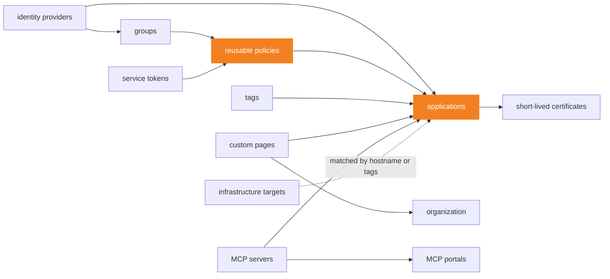

# cloudflare-zero-trust-access

> Published from [`cloudflare-zero-trust-access`](https://github.com/theobs-digital/cloudflare-terraform-modules/tree/cloudflare-zero-trust-access/v1.0.0/cloudflare-zero-trust-access) in [cloudflare-terraform-modules](https://github.com/theobs-digital/cloudflare-terraform-modules), where issues and pull requests go.

[](CHANGELOG.md)
[](#requirements)
[](https://registry.terraform.io/providers/cloudflare/cloudflare/latest)
[](LICENSE)

**All of Cloudflare Access in one module block: the Zero Trust organization,
identity providers, groups and policies, applications of every type, service
tokens, certificates, and the MCP servers and portals of AI controls.**

- 🧩 **The provider, unchanged.** 15 resources, every attribute that is not
  deprecated, under its provider name. If you know `cloudflare/cloudflare`,
  you already know this module.
- 🔗 **Objects that refer to each other.** A policy names a group, an
  application a policy, a portal a server, through the module's outputs, in
  the same block.
- 📥 **Adopt what exists.** The import example brings an existing Access setup
  under Terraform by name, without copying an ID from the dashboard.
- 🔬 **Checked against the real API.** What Cloudflare refuses, rewrites or
  never returns was observed on a Zero Trust organization with provider
  5.28.0, and is written here.

> [!IMPORTANT]
> The first apply of `organization` resets every setting it leaves out, and
> its plan does not show it. Import the organization first, see
> [Adopt the organization](#adopt-the-organization).

**[Quick start](#quick-start)** · **[Inputs](#inputs)** ·
**[Outputs](#outputs)** · **[Watch out](#watch-out)** ·
**[Guides](#guides)** · **[Requirements](#requirements)**

## Quick start

**1. Create the Zero Trust organization** in the Zero Trust dashboard, if the
account has none: Terraform does not create it, and the dashboard picks its
team name.

**2. Create an API token** with these account permissions, as Cloudflare's
[API token permissions](https://developers.cloudflare.com/fundamentals/api/reference/permissions/)
and API schema list them, and export it as `CLOUDFLARE_API_TOKEN`. Grant only
those of the inputs you use:

| Permission | Covers |
|---|---|
| Access: Organizations, Identity Providers, and Groups → Edit | `organization`, identity providers, groups, signing keys |
| Access: Apps and Policies → Edit | applications, policies, short-lived certificates |
| Access: Service Tokens → Edit | service tokens |
| Access: Mutual TLS Certificates → Edit | mTLS certificates and hostname settings |
| Access: Custom Pages → Edit | custom pages |
| Access: Tags → Edit | tags |
| MCP Portals → Edit | MCP servers and portals |
| Zero Trust → Edit | infrastructure targets |

The API schema names the MCP permission, and the documentation of
infrastructure targets only names Zero Trust → Edit, which covers all of
Cloudflare One. The permissions page also lists finer ones, such as
Access: Apps → Edit or Access: Groups → Edit.

**3. Call the module:**

```hcl
module "access" {
  source = "github.com/theobs-digital/cloudflare-terraform-modules//cloudflare-zero-trust-access?ref=cloudflare-zero-trust-access/v1.0.0"

  account_id = "023e105f4ecef8ad9ca31a8372d0c353"

  access_identity_providers = {
    otp = { name = "One-time PIN", type = "onetimepin", config = {} }
  }

  access_groups = {
    staff = {
      name    = "Staff"
      include = [{ email_domain = { domain = "example.com" } }]
      require = [{ login_method = { id = module.access.access_identity_provider_ids["otp"] } }]
    }
  }

  access_policies = {
    staff = {
      name     = "Staff"
      decision = "allow"
      include  = [{ group = { id = module.access.access_group_ids["staff"] } }]
    }
  }

  access_applications = {
    wiki = {
      name         = "Wiki"
      type         = "self_hosted"
      destinations = [{ type = "public", uri = "wiki.example.com" }]
      policies     = [{ id = module.access.access_policy_ids["staff"] }]
    }
  }
}
```

Find `account_id` in the dashboard, under **API** on a domain's **Overview**
page, or search "Copy account ID" from Account home.

**4. Apply, then check the token at the origin.** Access only sees the
requests that reach Cloudflare: `wiki.example.com` must be a proxied record of
a zone in the account, or the public hostname of a tunnel. The origin can
check the `aud` claim of each request's Access token against the
`access_application_auds` output.

> [!TIP]
> The module comes from Git, with a release tag in `ref`, see the
> [repository README](https://github.com/theobs-digital/cloudflare-terraform-modules/blob/cloudflare-zero-trust-access/v1.0.0/README.md#usage). It is not on the Terraform Registry
> yet.

More in the examples: [basic](examples/basic) (a policy and an application),
[complete](examples/complete) (every input) and [import](examples/import) (an
existing setup brought under Terraform without changing it).

### How it works

The module works at the account level: Access objects attached to a zone are
not covered. Each input drives one provider resource, one per entry of a map.
Leave an input out, and the module creates nothing for it; leave a singleton out
(`organization`, `access_key_configuration`, `access_mtls_hostname_settings`),
and the module leaves that setting of the account alone.

Objects refer to each other through the module's outputs, such as
`group = { id = module.access.access_group_ids["staff"] }`: the attribute
keeps the provider's meaning, an ID, whether the object lives in this module
block or elsewhere. An arrow goes from an object to those that can refer to
it in the same block:



Two consequences, both from how Terraform orders the work, by input and by
output rather than by entry:

- **An object cannot refer to an object of the same kind in the same block**,
  such as a group inside a group, nor two kinds to each other, such as a
  policy with a `linked_app_token` rule toward an application of the block,
  when applications of the block refer to its policies. Terraform reports a
  cycle. Declare the inner object in a second module block, see
  [Split objects into two blocks](#split-objects-into-two-blocks).
- **Every entry of an input waits for every object behind each output its
  entries refer to.** When one of them fails, Terraform creates none of these
  entries: a refused custom page holds back every application, even those
  without it, and a refused application every short-lived certificate.

### Why a module

Cloudflare's [Terraform best practices](https://developers.cloudflare.com/terraform/advanced-topics/best-practices/#avoid-modules-or-use-them-sparingly)
advise to avoid modules, or to use them sparingly: a module that hides
resources behind its own logic can change them in ways its caller does not
see, and adds its own bugs to those of Terraform and the provider. This one
has no logic of its own. Each entry is one provider resource, with the
provider's attributes, nothing computed or defaulted on the way, and the plan
shows the provider's resources as they are, under `module.access`. What the
module adds is the typing of every attribute, the references between
objects, and what this README records of the API.

## Inputs

| Input | Type | Default | Description |
|---|---|---|---|
| `account_id` | `string` | **required** | the account that owns the Zero Trust organization |
| `organization` | `object` | `null` | settings of the organization, see [Organization](#organization) |
| `access_identity_providers` | `map(object)` | `{}` | how users log in, see [Identity providers](#identity-providers) |
| `access_groups` | `map(object)` | `{}` | reusable sets of rules, see [Groups and policies](#groups-and-policies) |
| `access_policies` | `map(object)` | `{}` | reusable policies, see [Groups and policies](#groups-and-policies) |
| `access_applications` | `map(object)` | `{}` | what Access protects, 14 types, see [Applications](#applications) |
| `access_service_tokens` | `map(object)` | `{}` | credentials for machines, see [Service tokens](#service-tokens) |
| `access_mtls_certificates` | `map(object)` | `{}` | CAs of client certificates, paid plans, see [mTLS](#mtls) |
| `access_mtls_hostname_settings` | `object` | `null` | mTLS settings of the account's hostnames, see [mTLS](#mtls) |
| `access_short_lived_certificates` | `map(object)` | `{}` | SSH CAs of applications, see [Short-lived certificates](#short-lived-certificates) |
| `access_tags` | `map(object)` | `{}` | tags of applications, see [Tags and custom pages](#tags-and-custom-pages) |
| `access_custom_pages` | `map(object)` | `{}` | pages instead of Access's own, paid plans, see [Tags and custom pages](#tags-and-custom-pages) |
| `access_key_configuration` | `object` | `null` | rotation of the signing keys, see [Signing keys](#signing-keys) |
| `access_infrastructure_targets` | `map(object)` | `{}` | servers of `infrastructure` applications, see [Infrastructure targets](#infrastructure-targets) |
| `access_ai_controls_mcp_servers` | `map(object)` | `{}` | MCP servers, see [MCP servers and portals](#mcp-servers-and-portals) |
| `access_ai_controls_mcp_portals` | `map(object)` | `{}` | MCP portals, see [MCP servers and portals](#mcp-servers-and-portals) |

The key of a map is yours and only names the object in the Terraform state:
keep it stable, since [renaming it](#rename-a-key) replaces the object, with a
new ID. Each block below shows the attributes an input takes, with what they
do; the full type of every input is in the [Reference](#reference).
Attributes keep their provider names, and whatever you leave out keeps
Cloudflare's default, except in `organization`.

> [!WARNING]
> **A misspelled attribute is dropped without a word.** Terraform discards
> the attributes an input does not declare: `sesion_duration = "8h"` leaves
> the default duration, and the plan shows no error. Check the names against
> the blocks on this page.

> [!NOTE]
> **Secrets go through sensitive variables**: `config.client_secret` of an
> identity provider, `scim_config.authentication` of an application,
> `auth_credentials` and `client_secret` of an MCP server. Never write them in
> a versioned file. Mark the variable that holds the secret, not the input:
> an input wrapped in `sensitive()` fails with "Invalid for_each argument".
> The provider masks them in the plan, but the state holds them in clear, as
> it holds the secrets Cloudflare generates: protect the backend.

### Organization

`organization` holds the settings of the account's Zero Trust organization.
Leave it out, and the module leaves the organization alone. Set it, and the
module owns every setting: a setting left out goes to `null`, or to `false`
for the five booleans so marked.

```hcl
organization = {
  # Write them as Cloudflare has them: <team>.cloudflareaccess.com.
  name        = "example.cloudflareaccess.com"
  auth_domain = "example.cloudflareaccess.com"

  session_duration                   = "24h"   # lifetime of the tokens Access issues for applications
  warp_auth_session_duration         = "24h"   # the same, for users authenticated through WARP
  user_seat_expiration_inactive_time = "730h"  # a seat inactive that long is freed

  # Sent as false when left out.
  allow_authenticate_via_warp = false  # users reach every application with their WARP session
  auto_redirect_to_identity   = false  # skip the choice of identity provider at login
  is_ui_read_only             = false  # lock the settings in the dashboard: API and Terraform only
  mfa_required_for_all_apps   = false  # apply mfa_config below to every application by default
  warp_auth_non_browser_401   = false  # answer 401, not the login page, to non-browser WARP requests

  # An organization at its defaults returns these: write them.
  deny_unmatched_requests                     = false  # true denies hostnames without an application
  deny_unmatched_requests_exempted_zone_names = []     # zones exempt from it

  # Kept when left out.
  mfa_configuration_allowed  = true                    # applications and policies may set their own MFA
  strict_service_token_auth  = true                    # 401 or 403, and an audit log, for a bad service token
  ui_read_only_toggle_reason = "Managed by Terraform"  # why is_ui_read_only changed

  login_design = {
    background_color = "#1e293b"
    text_color       = "#ffffff"
    header_text      = "Example"
    footer_text      = "For Example staff only"
    logo_path        = "https://www.example.com/logo.png"
  }

  # Custom pages, paid plans: see Tags and custom pages.
  custom_pages = {
    identity_denied = module.access.access_custom_page_ids["identity_denied"]  # after a failed identity rule
    forbidden       = module.access.access_custom_page_ids["forbidden"]        # after a failed non-identity rule
  }

  # Independent MFA, which policies and applications need for their own mfa_config.
  mfa_config = {
    allowed_authenticators        = ["totp", "biometrics", "security_key"]
    session_duration              = "24h"   # how often users go through MFA again
    amr_matching_session_duration = "12h"   # skip MFA when the identity provider already did it
    # required_aaguids            = "..."   # a list of the FIDO2 authenticators allowed
  }
  mfa_piv_key_requirements = {              # hardware keys, for infrastructure applications
    pin_policy          = "once"            # never, once or always
    touch_policy        = "always"          # never, always or cached
    require_fips_device = true
    ssh_key_type        = ["ecdsa", "ed25519"]
    ssh_key_size        = [256, 384]
  }

  # Unused service tokens: disable or delete them after some days.
  service_token_inactivity = { enabled = true, action = "disable", inactivity_threshold_days = 90 }
}
```

Terraform does not create the organization: its create updates the existing
one, and its destroy only drops it from the state. Removing `organization`
leaves the last values applied. Both warn about "Resource Destruction
Considerations"; the warning is harmless. Adopt the organization with an
import before the first apply, see
[Adopt the organization](#adopt-the-organization).

`mfa_config` turns on independent MFA, with at least one authenticator. Without
it, Cloudflare refuses every policy and application that sets `mfa_config`,
even `{ mfa_disabled = true }` alone: "organization must have at least one
allowed authenticator configured when apps or policies have mfa_config".

### Identity providers

```hcl
access_identity_providers = {
  entra = {
    name = "Microsoft Entra ID"  # required: shown on the login page
    type = "azureAD"             # required: see the table below. Changing it replaces the provider

    config = {                   # required: the fields of this type, {} for a one-time PIN
      client_id      = "4f2b7c1e-9d3a-4e8b-a6c5-1b2d3e4f5a6b"
      client_secret  = var.entra_client_secret  # sensitive, never returned by Cloudflare
      directory_id   = "9b2a1c3d-4e5f-6a7b-8c9d-0e1f2a3b4c5d"
      support_groups = true      # load the user's groups, for the azure_ad selector
    }

    scim_config = {
      enabled                  = true         # Cloudflare generates a SCIM URL and secret, see below
      user_deprovision         = true         # revoke the sessions of a user removed in the IdP
      seat_deprovision         = true         # and free their seat; needs user_deprovision
      identity_update_behavior = "automatic"  # how a SCIM event updates the identity policies see
    }

    read_only = false  # true: the API can no longer change or delete it
    # saml_certificate_set_id = "..."  # SAML: the certificate set that encrypts assertions
  }
}
```

`type` takes `onetimepin`, `azureAD`, `saml`, `centrify`, `facebook`,
`github`, `google-apps`, `google`, `linkedin`, `oidc`, `okta`, `onelogin`,
`pingone`, `yandex`, `cloudflare` or `passkeys`. `config` gathers the fields
of every type: set those of yours, listed in Cloudflare's
[identity provider guides](https://developers.cloudflare.com/cloudflare-one/identity/idp-integration/).
The provider refuses at plan, not at validate, these fields on another type:

| `type` | Fields of `config` for this type only |
|---|---|
| `azureAD` | `directory_id`, `conditional_access_enabled`, `support_groups`, `prompt` |
| `centrify` | `centrify_account`, `centrify_app_id` |
| `google-apps` | `apps_domain` |
| `oidc` | `auth_url`, `token_url`, `certs_url`, `scopes` |
| `okta` | `okta_account`, `authorization_server_id` |
| `onelogin` | `onelogin_account` |
| `pingone` | `ping_env_id` |
| `saml` | `issuer_url`, `sso_target_url`, `idp_public_certs`, `attributes`, `email_attribute_name`, `header_attributes`, `sign_request` |

#### SCIM

With `scim_config.enabled = true`, Cloudflare generates the SCIM secret. Give
the identity provider `scim_base_url` and `secret`, from the sensitive output
`access_identity_provider_scim_configs`, such as
`module.access.access_identity_provider_scim_configs["entra"].secret`.

Cloudflare returns the secret only when SCIM is first enabled, and the
provider keeps it in the state. A provider imported with SCIM on has no
secret there: refresh it through the API
(`/access/identity_providers/<ID>/refresh_scim_secret`), as the provider
documentation says, and give the new one to the identity provider.

### Groups and policies

A group is a reusable set of rules; a policy decides what happens to the
users its rules match. Applications refer to policies, policies to groups.

```hcl
access_groups = {
  staff = {
    name    = "Staff"                                          # required
    include = [{ email_domain = { domain = "example.com" } }]  # required: match at least one rule
    require = [{ login_method = { id = module.access.access_identity_provider_ids["entra"] } }]  # match every rule
    exclude = [{ geo = { country_code = "KP" } }]               # match none
    # is_default = true                                        # never read back, see Watch out
  }
}

access_policies = {
  staff = {
    name     = "Staff"  # required
    decision = "allow"  # required: allow, deny, non_identity (service tokens) or bypass
    include  = [{ group = { id = module.access.access_group_ids["staff"] } }]
    exclude  = [{ geo = { country_code = "KP" } }]
    # require = [ ... ]

    session_duration = "8h"  # lifetime of the token of a user this policy lets in

    # Ask an administrator, and a reason, at the start of each session.
    approval_required              = true
    approval_groups                = [{ approvals_needed = 1, email_addresses = ["it@example.com"] }]
    purpose_justification_required = true
    purpose_justification_prompt   = "Ticket number"

    # mfa_config       = { allowed_authenticators = ["totp"], session_duration = "12h" }  # needs organization.mfa_config
    # isolation_required = true  # needs Cloudflare Browser Isolation on the account
    # connection_rules   = { rdp = { allowed_clipboard_local_to_remote_formats = ["text"] } }  # RDP applications
  }
}
```

A user must match at least one rule of `include`, every rule of `require`,
and no rule of `exclude`. Each rule sets a single selector: the provider
refuses a rule with two at plan. `everyone`, `any_valid_service_token` and
`certificate` take no value, as in `everyone = {}`. A group keeps the order
of its rules; a policy does not. `non_identity` is the Service Auth decision,
for machines.

**The 26 selectors** of a rule, as Cloudflare's
[Access selectors](https://developers.cloudflare.com/cloudflare-one/access-controls/policies/#selectors)
describe them. The last column marks those that Cloudflare's documentation
lists for the policies of an `infrastructure` application, see
[Policies of an application](#policies-of-an-application):

| Selector | Fields | Matches | Infrastructure |
|---|---|---|---|
| `email` | `email` | one email address | ✅ |
| `email_domain` | `domain` | emails ending in this domain | ✅ |
| `email_list` | `id` | the emails of a Zero Trust list | |
| `everyone` | — | every user | |
| `group` | `id` | the users of an Access group | |
| `login_method` | `id` | users who logged in with this identity provider | |
| `auth_method` | `auth_method` | the MFA method the identity provider reports, such as `mfa` or `hwk` | ✅ |
| `azure_ad` | `id`, `identity_provider_id` | an Entra ID group | ✅ |
| `github_organization` | `name`, `identity_provider_id`, `team` | a GitHub organization or team | ✅ |
| `gsuite` | `email`, `identity_provider_id` | a Google Workspace group | ✅ |
| `okta` | `name`, `identity_provider_id` | an Okta group | ✅ |
| `saml` | `attribute_name`, `attribute_value`, `identity_provider_id` | a SAML attribute | ✅ |
| `oidc` | `claim_name`, `claim_value`, `identity_provider_id` | an OIDC claim | |
| `auth_context` | `ac_id`, `id`, `identity_provider_id` | an Entra ID authentication context | |
| `cloudflare_account_member` | `account_id`, optional | members of a Cloudflare account, this one by default | |
| `user_risk_score` | `user_risk_score` | a risk score, Enterprise plans | |
| `external_evaluation` | `evaluate_url`, `keys_url` | the answer of your own API | |
| `geo` | `country_code` | the country of the IP address | ✅ |
| `ip` | `ip` | an IP range | |
| `ip_list` | `id` | the IPs of a Zero Trust list | |
| `device_posture` | `integration_uid` | a device posture rule that passed | ✅ |
| `certificate` | — | any valid client certificate, see [mTLS](#mtls) | |
| `common_name` | `common_name` | a client certificate with this common name | |
| `service_token` | `token_id` | one service token, with `non_identity` | |
| `any_valid_service_token` | — | any service token of the account, with `non_identity` | |
| `linked_app_token` | `app_uid` | an OAuth token an application issued, with `non_identity` | |

`device_posture` takes the ID of a device posture **rule**
(`cloudflare_zero_trust_device_posture_rule`), despite its name and the
provider's description, which speak of an integration. Cloudflare accepts any
ID there without checking it.

`isolation_required = true` needs
[Cloudflare Browser Isolation](https://developers.cloudflare.com/cloudflare-one/access-controls/policies/isolate-application/)
on the account. An account without it refuses the policy: "missing required
permission to enable isolation_required".

### Applications

```hcl
access_applications = {
  wiki = {
    name = "Wiki"         # shown to users
    type = "self_hosted"  # see the table below; set it, or type-specific attributes fail

    destinations = [{ type = "public", uri = "wiki.example.com" }]  # what it protects, see below
    # domain     = "wiki.example.com"  # left out: the first public destination

    policies = [  # by ascending precedence, see Policies of an application
      { id = module.access.access_policy_ids["staff"], precedence = 1 },
      { id = module.access.access_policy_ids["contractors"], precedence = 2 },
    ]

    allowed_idps              = [module.access.access_identity_provider_ids["entra"]]  # default: all
    auto_redirect_to_identity = true   # skip the choice of identity provider; needs one in allowed_idps
    session_duration          = "24h"  # lifetime of the application token
    app_launcher_visible      = true   # show it in the App Launcher
    logo_url                  = "https://www.example.com/wiki.svg"
    tags                      = [module.access.access_tag_ids["engineering"]]  # by name, see Tags

    # When access is denied.
    custom_deny_message          = "Ask the IT team"  # none of ,.!:@?-
    custom_deny_url              = "https://www.example.com/denied"
    custom_non_identity_deny_url = "https://www.example.com/denied-device"
    custom_pages                 = [module.access.access_custom_page_ids["identity_denied"]]  # paid plans

    # Cookies and HTTP.
    enable_binding_cookie      = false     # bind the token to the browser, against stolen tokens
    http_only_cookie_attribute = true      # HttpOnly cookie, against XSS
    same_site_cookie_attribute = "lax"     # SameSite cookie, against CSRF
    path_cookie_attribute      = false     # scope the token to the application path
    allow_iframe               = false
    skip_interstitial          = false     # automatic authentication through cloudflared
    service_auth_401_redirect  = true      # 401 when a Service Auth policy blocks the request
    options_preflight_bypass   = false     # let CORS preflight requests through; not with cors_headers
    # cors_headers = { allowed_origins = ["https://www.example.com"], allowed_methods = ["GET"], allow_credentials = true, max_age = 600 }
    # read_service_tokens_from_header = "Authorization"  # a service token in one header

    allow_authenticate_via_warp = true  # let WARP-authenticated users in; overrides the organization
    # mfa_config = { allowed_authenticators = ["security_key"], session_duration = "12h" }  # needs organization.mfa_config

    # oauth_configuration = { ... }  # Access as the OAuth server of the application, in beta
  }
}
```

**The 14 types** are `self_hosted`, `saas`, `ssh`, `vnc`, `rdp`,
`app_launcher`, `warp`, `biso`, `bookmark`, `dash_sso`, `infrastructure`,
`mcp`, `mcp_portal` and `proxy_endpoint`. Many attributes belong to a few
types, and the provider refuses them at plan, not at validate, when `type` is
another one or is left out:

| Attribute | Types |
|---|---|
| `saas_app`, required for these types | `saas`, `dash_sso` |
| `destinations` | `self_hosted`, `ssh`, `vnc`, `rdp`, `mcp_portal`, `mcp` |
| `allow_iframe`, `cors_headers`, `enable_binding_cookie`, `http_only_cookie_attribute`, `options_preflight_bypass`, `path_cookie_attribute`, `read_service_tokens_from_header`, `same_site_cookie_attribute`, `service_auth_401_redirect`, `skip_interstitial` | `self_hosted`, `ssh`, `vnc`, `rdp`, `mcp_portal` |
| `mfa_config` | `self_hosted`, `ssh`, `vnc`, `rdp` |
| `allow_authenticate_via_warp` | `self_hosted`, `ssh`, `vnc`, `rdp`, `saas`, `dash_sso` |
| `app_launcher_visible` | `self_hosted`, `ssh`, `vnc`, `rdp`, `saas`, `bookmark` |
| `target_criteria` | `rdp`, `infrastructure` |
| `app_launcher_logo_url`, `bg_color`, `footer_links`, `header_bg_color`, `landing_page_design`, `skip_app_launcher_login_page` | `app_launcher` |
| `session_duration` | every type but `biso` and `bookmark` |

**`destinations`** lists what the application protects: public hostnames and
paths (`uri`, with wildcards), private networks (`cidr` or `hostname`, with
`port_range`, `l4_protocol` and the `vnet_id` of a virtual network), Workers
(`worker_id`) and, for an `mcp` application, MCP servers (`mcp_server_id`).
`type` defaults to `public`. The Free plan accepts private destinations.
`self_hosted_domains`, deprecated in favor of `destinations`, is left out of
the module.

#### Policies of an application

`policies` lists the policies that Access applies to the application, by
ascending `precedence`, unique within the application. The provider numbers
an entry without `precedence` after the previous one. Leaving `policies` out
sends an empty list: the application keeps no policy.

Every type but `infrastructure` takes reusable policies, by ID, as above.
An `infrastructure` application only takes policies written inside it, with
the rules of `access_policies` and the Unix users that may connect in
`connection_rules.ssh`. Cloudflare's API offers no reference for this type,
reusable policies have no `connection_rules.ssh`, and the provider refuses a
reference at plan: "connection_rules has to be set if type is
infrastructure".

```hcl
access_applications = {
  databases = {
    name = "Databases"
    type = "infrastructure"
    target_criteria = [{
      port     = 22
      protocol = "SSH"
      include  = { tags = { environment = ["production"] } }  # or target_attributes = { hostname = [...] }
      # require = { ... }, exclude = { ... }
    }]
    policies = [{
      name             = "SRE"
      decision         = "allow"  # the only decision of this type
      include          = [{ email = { email = "sre@example.com" } }]
      connection_rules = { ssh = { usernames = ["root"], allow_email_alias = false } }
    }]
  }
}
```

These policies take only some selectors, marked in the
[selectors table](#groups-and-policies). Cloudflare refuses the others, an
Access group included: "rule type 'group' not supported by infrastructure
apps" (code 12130).

For the other types, Cloudflare calls a policy written inside an application
legacy: its documentation says that one cannot be added to a new application,
though the API still accepts it. Write reusable policies there. Cloudflare's
API describes reusable and written policies as mutually exclusive within an
application.

`target_criteria` selects the targets of an `infrastructure` or `rdp`
application, by `target_attributes.hostname` or by `tags`, in `include`, with
optional `require` and `exclude`, the rule format of provider 5.28. The
provider describes the top-level `target_attributes` map as deprecated,
without flagging it: it remains for applications that still use it, and
cannot be combined with the rule format.

#### SaaS applications

```hcl
access_applications = {
  crm = {
    name = "CRM"
    type = "saas"
    saas_app = {
      auth_type     = "oidc"  # or saml, the default
      redirect_uris = ["https://crm.example.net/oauth/callback"]
      grant_types   = ["authorization_code"]
      scopes        = ["openid", "email", "profile"]
      # SAML instead: sp_entity_id, consumer_service_url, name_id_format = "email", custom_attributes...
    }
    policies = [{ id = module.access.access_policy_ids["staff"] }]
  }
}
```

The sensitive output `access_application_saas_apps` gives what Cloudflare
generates: `client_id`, `client_secret` and `public_key` for OIDC, where
`client_id` equals the AUD; `idp_entity_id`, `sso_endpoint` and `public_key`
for SAML. Cloudflare returns `client_secret` only at creation, and the
provider keeps it in the state: an application imported has none.

`scim_config` provisions users to the application by SCIM, which Cloudflare
describes as a closed beta: `idp_uid`, `remote_uri`, `authentication`,
`mappings`. A rule `linked_app_token` accepts the OAuth tokens an OIDC SaaS
application issues, by its ID.

### Service tokens

A service token lets a machine through Access: it sends the
`CF-Access-Client-Id` and `CF-Access-Client-Secret` headers, from the outputs
`access_service_token_client_ids` and `access_service_token_client_secrets`
(sensitive). Its application needs a policy with the decision `non_identity`
and a rule `service_token`, or `any_valid_service_token = {}` for every
token of the account.

```hcl
access_service_tokens = {
  ci = {
    name     = "CI"     # required
    duration = "8760h"  # default 8760h (one year); forever never expires
    enabled  = true     # false: both secrets stop working, the token stays

    # Rotation, see Rotate a service token secret.
    # client_secret_version             = 2
    # previous_client_secret_expires_at = "2026-11-01T00:00:00Z"
  }
}

access_policies = {
  ci = {
    name     = "CI"
    decision = "non_identity"
    include  = [{ service_token = { token_id = module.access.access_service_token_ids["ci"] } }]
  }
}
```

A token expires after `duration`. Terraform does not renew it, and its plan
shows nothing as the date nears; Cloudflare's notification "Expiring Access
Service Token" warns a week before. Every update of a token, a rename
included, sets its expiration again to `duration` from the time of the
update: the provider sends `duration` with each update. Cloudflare returns
the secret only at creation and at rotation, and the provider keeps it in the
state.

### mTLS

```hcl
access_mtls_certificates = {
  corporate = {
    name                 = "Corporate CA"           # required
    certificate          = var.client_ca_certificate  # required: the CA in PEM, with its chain
    associated_hostnames = ["api.example.com"]      # applications that ask for a client certificate
  }
}

# The whole list of the account: list every hostname.
access_mtls_hostname_settings = {
  settings = [{
    hostname                      = "api.example.com"
    client_certificate_forwarding = true   # Cf-Client-Cert-Der-Base64 and Cf-Client-Cert-Sha256 headers to the origin
    china_network                 = false  # also in China, on a zone with the China Network
  }]
}
```

The policies of these applications accept a certificate with the rule
`certificate = {}`, or `common_name`. See Cloudflare's
[mutual TLS guide](https://developers.cloudflare.com/cloudflare-one/access-controls/service-credentials/mutual-tls-authentication/)
for the requirements on the CA. Changing `certificate` replaces the
certificate. To destroy one, the provider first empties its
`associated_hostnames`.

mTLS certificates need a pay-as-you-go or Enterprise plan. On the Free plan,
Cloudflare refuses a certificate, even on an account that has none: "maximum
number of certificates has been reached" (code 12130). They are tested with
mocks and a local copy of the API only.

#### Hostname settings

`access_mtls_hostname_settings` is a setting of the account. Leave it out,
and the module leaves it alone. The provider's create updates the existing
list, and its destroy only drops it from the state: removing it leaves the
last settings applied, with the harmless "Resource Destruction
Considerations" warning. The provider never reads `settings` back: a change
made outside Terraform does not show in the plan. The Free plan accepts the
list, tried empty only.

### Short-lived certificates

Each entry creates the SSH certificate authority of an application. Access
signs short-lived certificates for its users, and the SSH server trusts them
through the CA's public key, from the output
`access_short_lived_certificate_public_keys`, in `TrustedUserCAKeys`.

```hcl
access_short_lived_certificates = {
  ssh = { app_id = module.access.access_application_ids["ssh"] }  # changing it replaces the CA and its key
}
```

Cloudflare calls this setup legacy, and recommends `infrastructure`
applications for new SSH deployments.

### Tags and custom pages

```hcl
access_tags = {
  hr = { name = "Human Resources" }  # also the tag's ID: renaming it replaces the tag
}

access_custom_pages = {
  identity_denied = {
    name             = "Identity denied"
    type             = "identity_denied"  # identity_denied, forbidden, login or interstitial
    custom_html      = "<html><body><h1>Access denied</h1></body></html>"
    contract_version = 1                  # a Liquid template Cloudflare sanitizes; left out: served as written
  }
}
```

An application takes up to 25 tags in `tags`, by name, and users filter the
App Launcher by them. Cloudflare refuses an application with a tag that does
not exist yet: "tags must be created before assigning to an application"
(code 12130). Refer to a tag of the same block through `access_tag_ids`, as
in [Applications](#applications), so that Terraform creates it first.

A custom page replaces Access's own page: `identity_denied` is shown to a
user who fails an identity rule, after login; `forbidden` to a user who fails
a non-identity rule, such as a country or a device posture, before login.
The API also accepts `login` and `interstitial`, which Cloudflare's
documentation does not describe. An application refers to its pages in
`custom_pages`, the organization in `custom_pages.identity_denied` and
`custom_pages.forbidden`, through `access_custom_page_ids`.

Custom pages need a pay-as-you-go or Enterprise plan. On the Free plan,
Cloudflare refuses a page: "account does not have permission for custom
pages" (HTTP 403, code 12133). While one fails, Terraform creates none of the
applications, see [How it works](#how-it-works). They are tested with mocks
only.

### Signing keys

```hcl
access_key_configuration = { key_rotation_interval_days = 42 }  # 21 to 365, checked at plan
```

Cloudflare rotates the keys that sign Access tokens every 42 days by default.
Leave the input out, and the module leaves the setting alone; removing it
leaves the last interval applied. Origins that check the signature of the
token must fetch the keys from
`https://<team>.cloudflareaccess.com/cdn-cgi/access/certs` rather than pin
them: Cloudflare keeps the previous key valid for 7 days after a rotation.
Terraform does not rotate the keys on demand: that is
`POST /accounts/<account>/access/keys/rotate`.

### Infrastructure targets

A target is a server that `infrastructure` applications reach over SSH.

```hcl
access_infrastructure_targets = {
  db1 = {
    hostname = "db-1"  # required: names the target for Access only, not resolved, not unique
    ip = {             # required: IPv4, IPv6 or both
      ipv4 = { ip_addr = "10.0.0.11", virtual_network_id = var.virtual_network_id }  # left out: the default network
      # ipv6 = { ip_addr = "fd00::11" }
    }
    tags = { environment = "production" }  # one value per key, matched by target_criteria
  }
}
```

An address belongs to one target only within a virtual network. Cloudflare
accepts an address that no tunnel route covers yet. `virtual_network_id`
takes the ID of a virtual network, such as
`cloudflare_zero_trust_tunnel_cloudflared_virtual_network.x.id`. These
`tags` are not the Access tags above. An application selects its targets by
`hostname` or `tags`, not by ID, so it does not depend on them.

### MCP servers and portals

An MCP server is reached over HTTP; a portal is a single MCP endpoint for
several servers, on a hostname of the account.

```hcl
access_ai_controls_mcp_servers = {
  docs = {
    id        = "docs"                                # required, yours: prefixes its tools, use hyphens
    name      = "Cloudflare docs"                     # required
    hostname  = "https://docs.mcp.cloudflare.com/mcp" # required: the full URL of the endpoint
    auth_type = "unauthenticated"                     # required: unauthenticated, bearer or oauth
    # auth_credentials = var.mcp_token  # bearer: the token, or a JSON object of headers; sensitive
    # client_secret    = var.mcp_secret # oauth with a client registered by hand; sensitive
    description = "Product documentation"
    # secure_web_gateway = true         # route its traffic through Gateway
    # updated_tools   = [{ name = "delete_page", enabled = false }]  # hide or rename tools
    # updated_prompts = [{ name = "summarize", alias = "digest" }]
  }
}

access_ai_controls_mcp_portals = {
  main = {
    id       = "main"             # required, yours
    name     = "MCP"              # required
    hostname = "mcp.example.com"  # required: a hostname in a zone of the account
    servers = [{
      server_id        = module.access.access_ai_controls_mcp_server_ids["docs"]
      on_behalf        = true   # default: each user authorizes with their own credentials
      default_disabled = false  # true: off for clients until they turn it on
    }]
    code_mode = "opt_in"  # default; off, default_on or enforced
  }
}
```

`id` prefixes the name of each tool and prompt the server exposes through a
portal, as `<id>_<tool>`. The portal splits that name at the first
underscore: use hyphens in `id`, not underscores. Changing `id`, `auth_type`
or `hostname` of a server, or `id` of a portal, replaces it. Cloudflare
connects to a server when it creates it: a server it cannot reach is still
created, in status `error`. Set `on_behalf = false` to use the server's admin
credential, which service tokens need. `allow_code_mode`, deprecated, is left
out of the module.

Unlike the dashboard, the API creates neither the DNS record of the portal
nor its Access applications: see [Publish an MCP portal](#publish-an-mcp-portal).
The Free plan accepts servers, portals and their applications.

## Outputs

| Output | Use it for |
|---|---|
| `access_application_auds` | 👉 the origin: check the `aud` claim of the Access token |
| `access_application_saas_apps` | 👉 the SaaS application: OIDC client or SAML endpoints, sensitive. See [SaaS applications](#saas-applications) |
| `access_identity_provider_scim_configs` | 👉 the identity provider: SCIM URL and secret, sensitive. See [SCIM](#scim) |
| `access_service_token_client_ids` | 👉 the machine: the `CF-Access-Client-Id` header |
| `access_service_token_client_secrets` | 👉 the machine: the `CF-Access-Client-Secret` header, sensitive |
| `access_short_lived_certificate_public_keys` | 👉 the SSH servers: `TrustedUserCAKeys` |
| `access_identity_provider_ids` | rules `login_method`, `azure_ad`…, and `allowed_idps` of applications |
| `access_group_ids` | rules `group` |
| `access_policy_ids` | `policies` of applications |
| `access_application_ids` | short-lived certificates, rules `linked_app_token` |
| `access_service_token_ids` | rules `service_token` |
| `access_tag_ids` | `tags` of applications: a tag's ID is its name |
| `access_custom_page_ids` | `custom_pages` of applications and of the organization |
| `access_ai_controls_mcp_server_ids` | `servers` of portals, `destinations` of `mcp` applications |
| `access_mtls_certificate_ids` | the IDs of the mTLS certificates |
| `access_infrastructure_target_ids` | the IDs of the targets |

Each output is a map by key of its input. The CAs of short-lived certificates
have no ID output, since their ID is the application's, nor do MCP portals,
whose ID is the `id` you give.

## Watch out

**🔴 Can lock users out or break machines**

- **The first apply of `organization` without an import** resets every
  setting it leaves out, and its plan does not show it. See
  [Adopt the organization](#adopt-the-organization).
- **Renaming a key, changing `type` of an identity provider, or replacing
  your own resources with the module** replaces the object, with a new ID: the AUD of an application changes, and origins that
  check it refuse its users; a service token gets a new client ID and secret;
  a short-lived certificate gets a new public key. Declare the move, see
  [Rename a key](#rename-a-key) and
  [Move resources into the module](#move-resources-into-the-module).
- **Leaving `policies` out of an application** sends an empty list: the
  application keeps no policy.
- **An `import` block on an mTLS certificate** plans to replace it, which
  drops it from its hostnames: see
  [Import an mTLS certificate](#import-an-mtls-certificate).
- **`access_mtls_hostname_settings`** replaces the whole list of the account.
- **Changing `account_id`** replaces every object of the module.

**🟠 Surprises at apply**

- **Paid features on the Free plan** fail: mTLS certificates and custom pages,
  and while a page fails, every application of the block waits.
- **A policy of an `infrastructure` application** refuses an Access group,
  and most other selectors: see [Policies of an application](#policies-of-an-application).
- **`mfa_config`** of a policy or an application fails without
  `organization.mfa_config`; **`isolation_required`** without Browser
  Isolation.
- **`custom_deny_message`** fails with any of `,.!:@?-`.
- **Every update of a service token**, a rename included, restarts its
  expiration from `duration`.
- **A misspelled attribute** is dropped without an error: see [Inputs](#inputs).

**🟡 A change at every plan**

- After an import, some values Cloudflare returns and a configuration leaves
  out, and secrets it never returns: see
  [Adopt an existing setup](#adopt-an-existing-setup).
- `is_default` of a group, which the provider never reads back, shows as an
  update after an import when you set it.

**🔵 Harmless, good to know**

- `organization`, `access_key_configuration` and
  `access_mtls_hostname_settings` warn about "Resource Destruction
  Considerations": removing them resets nothing.
- The provider never reads `settings` of the hostname settings back: a change
  made in the dashboard does not show in the plan.
- An MCP server Cloudflare cannot reach is created anyway, in status `error`.

**🐞 Known provider issues**, open on 17 October 2026, and what the tests of
this module saw with provider 5.28.0:

| Issue | Reported | Seen here |
|---|---|---|
| [#7120](https://github.com/cloudflare/terraform-provider-cloudflare/issues/7120) | An `mcp` application, imported, plans `enable_binding_cookie` and `options_preflight_bypass` to `null` at every plan (5.19.1). | After an import only, and one apply clears it, see [Adopt an existing setup](#adopt-an-existing-setup). |
| [#7156](https://github.com/cloudflare/terraform-provider-cloudflare/issues/7156) | A policy reads back with extra empty `certificate = {}` rules, and `exclude = []` or `require = []` as `null`; an `app_launcher` application plans a `title` in `landing_page_design` (5.19.1). | Not seen: policies with `certificate = {}` and other selectors plan no change after creation. Not tried: empty lists, which you can leave out, and `app_launcher` on the API. |
| [#7165](https://github.com/cloudflare/terraform-provider-cloudflare/issues/7165) | A policy plans an update at every plan, with no attribute shown, with `session_duration = ""` (5.19.1). | Not seen: the tests never set `session_duration = ""`. |
| [#7238](https://github.com/cloudflare/terraform-provider-cloudflare/issues/7238) | An MCP server with `bearer` fails every apply after the first, "Provider produced inconsistent result after apply", its `status` going from `error` to `waiting` (5.21.1). | Not seen: a bearer server in status `error` was updated without an error. |

## Guides

### Adopt the organization

The first apply sends only the attributes of `organization`, plus `false`
for five booleans the provider defaults (`allow_authenticate_via_warp`,
`auto_redirect_to_identity`, `is_ui_read_only`, `mfa_required_for_all_apps`
and `warp_auth_non_browser_401`), and Cloudflare resets settings the request
leaves out, such as `session_duration`. Its plan shows none of this. Import
the organization first, by account ID, so that the plan shows each setting it
would change:

```hcl
import {
  to = module.access.cloudflare_zero_trust_organization.this[0]
  id = "023e105f4ecef8ad9ca31a8372d0c353"
}
```

Then copy into `organization` each value the plan sets to `null`. An
organization left at its defaults returns `deny_unmatched_requests = false`
and `deny_unmatched_requests_exempted_zone_names = []`: write them. It also
returns `service_token_inactivity` turned off, with `action` and
`inactivity_threshold_days` empty, which the provider refuses as input since
both are required. The plan then still shows `service_token_inactivity`
going to `null`, and `mfa_configuration_allowed` as known after apply.
Applying it leaves the organization as it was, and the next plan shows no
change.

### Adopt an existing setup

To bring identity providers, groups, policies and applications under the
module without changing them, follow the [import example](examples/import):
`import` blocks, with each object looked up by name in the provider's data
sources. For the other inputs, write an `import` block by hand, with the ID
below. `import` blocks need Terraform 1.5 or later; before, run
`terraform import` with the same address and ID.

| Input | Import ID | After the import, the plan shows |
|---|---|---|
| `organization` | `<account>` | `service_token_inactivity` to `null`, see [Adopt the organization](#adopt-the-organization) |
| `access_identity_providers` | `accounts/<account>/<id>` | `client_secret` as an update, never returned. A one-time PIN set up from the dashboard can have `name = ""`; Entra ID returns `conditional_access_enabled = false`. No SCIM secret, see [SCIM](#scim) |
| `access_groups` | `accounts/<account>/<id>` | no change |
| `access_policies` | `<account>/<id>` | no change. Created in the dashboard: `session_duration = "24h"` |
| `access_applications` | `accounts/<account>/<id>` | `false` returned for `auto_redirect_to_identity`, and `enable_binding_cookie` and `options_preflight_bypass` where the type takes them: write them. See below for `infrastructure` and `mcp` |
| `access_service_tokens` | `accounts/<account>/<id>` | `client_secret_version` as an update, see below |
| `access_mtls_certificates` | `accounts/<account>/<id>` | a replacement: see [Import an mTLS certificate](#import-an-mtls-certificate) |
| `access_mtls_hostname_settings` | `accounts/<account>` | `settings` as an update, never read back |
| `access_short_lived_certificates` | `accounts/<account>/<application id>` | no change |
| `access_tags` | `<account>/<name>` | no change |
| `access_custom_pages` | `<account>/<id>` | not checked: the Free plan refuses pages |
| `access_key_configuration` | `<account>` | no change, once the interval is written |
| `access_infrastructure_targets` | `<account>/<id>` | no change |
| `access_ai_controls_mcp_servers` | `<account>/<id>` | `auth_credentials` and `client_secret` as an update, never returned |
| `access_ai_controls_mcp_portals` | `<account>/<id>` | no change |

```hcl
import {
  to = module.access.cloudflare_zero_trust_access_service_token.this["ci"]
  id = "accounts/023e105f4ecef8ad9ca31a8372d0c353/3537a672-e4d8-4d89-aab9-26cb622918a1"
}
```

One apply clears the changes the configuration cannot avoid, and the next
plan shows no change:

- a secret Cloudflare never returns is sent again;
- an `infrastructure` application: the provider keeps only the ID of each
  policy at import, and this type refuses a reference. Applying sends the
  policies again, and Cloudflare replaces each with an identical one under a
  new ID;
- an `mcp` application returns `enable_binding_cookie` and
  `options_preflight_bypass`, which the provider refuses for this type:
  applying sends them as `null`;
- a service token: applying sends the version Cloudflare already has, which
  does not rotate the secret, and the expiration starts over from
  `duration`. Cloudflare does not return the secret of an imported token:
  `access_service_token_client_secrets` gives `null` for it until the next
  rotation. For a token rotated before, write its current
  `client_secret_version`, which the API returns, with
  `previous_client_secret_expires_at`.

An application with a legacy policy: refer to that policy by its ID, as to a
reusable one. The plan then shows no change, and updates keep the policy and
its ID. To manage it as a reusable policy instead, convert it with
`PUT /accounts/<account>/access/apps/<app>/policies/<policy>/make_reusable`,
then import it into `access_policies`.

### Move resources into the module

When your configuration already manages these objects as its own resources,
such as `resource "cloudflare_zero_trust_access_application" "wiki"`,
replacing them with the module makes the plan destroy each object and create
it again: a new ID, a new AUD, new secrets. Declare each move instead, from
the resource to its entry in the module, under the key you give it:

```hcl
module "access" {
  # ...
  access_groups = {
    staff = { name = "Staff", include = [{ email_domain = { domain = "example.com" } }] }
  }
  access_applications = {
    wiki = {
      name         = "Wiki"
      type         = "self_hosted"
      destinations = [{ type = "public", uri = "wiki.example.com" }]
      policies     = [{ id = module.access.access_policy_ids["staff"], precedence = 1 }]
    }
  }
  # ...
}

moved {
  from = cloudflare_zero_trust_access_group.staff
  to   = module.access.cloudflare_zero_trust_access_group.this["staff"]
}

moved {
  from = cloudflare_zero_trust_access_application.wiki
  to   = module.access.cloudflare_zero_trust_access_application.this["wiki"]
}
```

Each entry takes the attributes of its resource, but `account_id`, and a
reference such as `cloudflare_zero_trust_access_policy.staff.id` becomes
`module.access.access_policy_ids["staff"]`. The plan then moves each object,
and has nothing to add, change or destroy:

```text
  # cloudflare_zero_trust_access_application.wiki has moved to module.access.cloudflare_zero_trust_access_application.this["wiki"]
  # cloudflare_zero_trust_access_group.staff has moved to module.access.cloudflare_zero_trust_access_group.this["staff"]
Plan: 0 to add, 0 to change, 0 to destroy.
```

A change in that plan is an attribute that the entry writes differently from
the resource: write it as the resource did. Applying records the moves in the
state, and sends nothing to Cloudflare. This was checked with Terraform 1.3.10
and 1.16.5 and provider 5.28.0, against a local copy of the API: the apply
only read the objects.

- A resource with `count` or `for_each` moves one instance at a time, such as
  `from = cloudflare_zero_trust_access_group.all["staff"]`.
- A setting of the account moves to `[0]`, such as
  `to = module.access.cloudflare_zero_trust_organization.this[0]`.
- Once every state of the configuration has applied them, the `moved` blocks
  can go.
- A `moved` block cannot leave its state. For objects that another
  configuration manages, forget them there, with a `removed` block or
  `terraform state rm`, see
  [Stop managing without deleting](#stop-managing-without-deleting), then
  import them here, see [Adopt an existing setup](#adopt-an-existing-setup).

### Import an mTLS certificate

The provider cannot read `certificate` back, and warns "MTLS certificate not
imported": the plan of an `import` block then replaces the certificate, which
drops it from its hostnames until the new one is created. Do not apply it.
Import with the `terraform import` command instead, then add the PEM to the
state by hand, exactly as the configuration gives it:

```bash
terraform import 'module.access.cloudflare_zero_trust_access_mtls_certificate.this["corp"]' accounts/023e105f4ecef8ad9ca31a8372d0c353/f174e90a-fafe-4643-bbbc-4a0ed4fc8415
terraform state pull > state.json
# In state.json, set the instance's attributes.certificate to the PEM,
# and increment serial.
terraform state push state.json
```

The next plan shows no change. This was checked against a local copy of the
API, since the Free plan refuses certificates.

### Split objects into two blocks

An object that refers to an object of the same kind, or two kinds that refer
to each other, go in a second module block, which gives its IDs through the
same outputs. A group inside a group:

```hcl
module "access_base_groups" {
  source     = "github.com/theobs-digital/cloudflare-terraform-modules//cloudflare-zero-trust-access?ref=cloudflare-zero-trust-access/v1.0.0"
  account_id = "023e105f4ecef8ad9ca31a8372d0c353"

  access_groups = {
    sre = { name = "SRE", include = [{ email = { email = "sre@example.com" } }] }
  }
}
```

and then `group = { id = module.access_base_groups.access_group_ids["sre"] }`
in the groups of the main block. A policy that accepts the tokens of an
application of the main block, with the applications that use it:

```hcl
module "access_api" {
  source     = "github.com/theobs-digital/cloudflare-terraform-modules//cloudflare-zero-trust-access?ref=cloudflare-zero-trust-access/v1.0.0"
  account_id = "023e105f4ecef8ad9ca31a8372d0c353"

  access_policies = {
    client_tokens = {
      name     = "Client tokens"
      decision = "non_identity"
      include  = [{ linked_app_token = { app_uid = module.access.access_application_ids["client"] } }]
    }
  }

  access_applications = {
    api = {
      name         = "API"
      type         = "self_hosted"
      destinations = [{ type = "public", uri = "api.example.com" }]
      policies     = [{ id = module.access_api.access_policy_ids["client_tokens"] }]
    }
  }
}
```

### Share values between applications

The module has no defaults of its own. To give many applications the same
values, merge them in your configuration: a value the application sets wins.

```hcl
locals {
  applications = {
    wiki = { name = "Wiki", destinations = [{ uri = "wiki.example.com" }] }
    jira = { name = "Jira", destinations = [{ uri = "jira.example.com" }] }
  }
}

module "access" {
  # ...
  access_applications = {
    for key, app in local.applications : key => merge({
      type                       = "self_hosted"
      policies                   = [{ id = module.access.access_policy_ids["staff"] }]
      session_duration           = "8h"
      http_only_cookie_attribute = true
    }, app)
  }
}
```

### Keep the configuration in YAML

Each input takes the same map from a YAML file. A misspelled key is dropped
there too, see [Inputs](#inputs), and an ID from the module's outputs cannot
be written in YAML: keep those entries, or the attributes that refer to an
output, in HCL.

```hcl
module "access" {
  # ...
  access_groups = yamldecode(file("${path.module}/groups.yaml"))
}
```

```yaml
staff:
  name: Staff
  include:
    - email_domain:
        domain: example.com
contractors:
  name: Contractors
  include:
    - email:
        email: alice@example.net
```

### Rotate a service token secret

Increment `client_secret_version` and set `previous_client_secret_expires_at`,
an RFC 3339 timestamp until which Cloudflare still accepts the previous
secret. The provider refuses one without the other. The client ID stays, and
`access_service_token_client_secrets` gives the new secret after the apply.
Keep both attributes afterwards, and increment the version again at the next
rotation.

```hcl
access_service_tokens = {
  ci = {
    name                              = "CI"
    client_secret_version             = 2
    previous_client_secret_expires_at = "2026-11-01T00:00:00Z"
  }
}
```

### Publish an MCP portal

The API creates neither the DNS record of the portal nor its Access
applications, which the dashboard does.

1. Create a proxied CNAME record from the portal's hostname to
   `gateway.agents.cloudflare.com`, such as with the
   [cloudflare-dns](https://github.com/theobs-digital/cloudflare-terraform-modules/blob/cloudflare-zero-trust-access/v1.0.0/cloudflare-dns/README.md) module, or the portal
   answers with errors 522.
2. Declare an `mcp_portal` application on the portal's hostname, and an `mcp`
   application per server, with the policies of its users:

```hcl
access_applications = {
  mcp_portal = {
    name         = "MCP"
    type         = "mcp_portal"
    destinations = [{ type = "public", uri = "mcp.example.com" }]
    policies     = [{ id = module.access.access_policy_ids["staff"] }]
  }
  mcp_docs = {
    name         = "Cloudflare docs"
    type         = "mcp"
    destinations = [{ type = "via_mcp_server_portal", mcp_server_id = module.access.access_ai_controls_mcp_server_ids["docs"] }]
    policies     = [{ id = module.access.access_policy_ids["staff"] }]
  }
}
```

### Rename a key

Renaming a key replaces the object, with a new ID. To rename a key without
touching Cloudflare, declare the move, with the resource of its input:

```hcl
moved {
  from = module.access.cloudflare_zero_trust_access_application.this["old"]
  to   = module.access.cloudflare_zero_trust_access_application.this["new"]
}
```

The resources are `cloudflare_zero_trust_access_<kind>.this`, such as
`..._identity_provider`, `..._group` or `..._service_token`, listed in the
[Reference](#reference).

### Stop managing without deleting

**The whole module.** Remove the `module` block and declare its removal
(Terraform 1.7 or later). The plan then shows each object as "will no longer
be managed by Terraform, but will not be destroyed". Before Terraform 1.7,
run `terraform state rm module.access` instead.

```hcl
removed {
  from = module.access

  lifecycle {
    destroy = false
  }
}
```

**One object.** A `removed` block cannot target one key of an input: forget
it with `terraform state rm`, then remove its entry.

```bash
terraform state rm 'module.access.cloudflare_zero_trust_access_application.this["wiki"]'
```

## Requirements

| | Version | Checked with |
|---|---|---|
| Terraform | `>= 1.3`, the first with optional object attributes | 1.3.10 and 1.16.5 |
| Provider [`cloudflare/cloudflare`](https://registry.terraform.io/providers/cloudflare/cloudflare/latest) | `~> 5.28`, which renamed `mfa_ssh_piv_key_requirements` of the organization to `mfa_piv_key_requirements` | 5.28.0 |

`import` blocks need Terraform 1.5 or later, and `removed` blocks and the
[import example](examples/import) 1.7. The provider reads its API token from
the `CLOUDFLARE_API_TOKEN` environment variable, with the permissions listed
in [Quick start](#quick-start).

## Reference

<details>
<summary><b>Every input and output, with its full type</b> (generated by terraform-docs)</summary>

<!-- BEGIN_TF_DOCS -->
### Resources

The following resources are used by this module:

- [cloudflare_zero_trust_access_ai_controls_mcp_portal.this](https://registry.terraform.io/providers/cloudflare/cloudflare/latest/docs/resources/zero_trust_access_ai_controls_mcp_portal) (resource)
- [cloudflare_zero_trust_access_ai_controls_mcp_server.this](https://registry.terraform.io/providers/cloudflare/cloudflare/latest/docs/resources/zero_trust_access_ai_controls_mcp_server) (resource)
- [cloudflare_zero_trust_access_application.this](https://registry.terraform.io/providers/cloudflare/cloudflare/latest/docs/resources/zero_trust_access_application) (resource)
- [cloudflare_zero_trust_access_custom_page.this](https://registry.terraform.io/providers/cloudflare/cloudflare/latest/docs/resources/zero_trust_access_custom_page) (resource)
- [cloudflare_zero_trust_access_group.this](https://registry.terraform.io/providers/cloudflare/cloudflare/latest/docs/resources/zero_trust_access_group) (resource)
- [cloudflare_zero_trust_access_identity_provider.this](https://registry.terraform.io/providers/cloudflare/cloudflare/latest/docs/resources/zero_trust_access_identity_provider) (resource)
- [cloudflare_zero_trust_access_infrastructure_target.this](https://registry.terraform.io/providers/cloudflare/cloudflare/latest/docs/resources/zero_trust_access_infrastructure_target) (resource)
- [cloudflare_zero_trust_access_key_configuration.this](https://registry.terraform.io/providers/cloudflare/cloudflare/latest/docs/resources/zero_trust_access_key_configuration) (resource)
- [cloudflare_zero_trust_access_mtls_certificate.this](https://registry.terraform.io/providers/cloudflare/cloudflare/latest/docs/resources/zero_trust_access_mtls_certificate) (resource)
- [cloudflare_zero_trust_access_mtls_hostname_settings.this](https://registry.terraform.io/providers/cloudflare/cloudflare/latest/docs/resources/zero_trust_access_mtls_hostname_settings) (resource)
- [cloudflare_zero_trust_access_policy.this](https://registry.terraform.io/providers/cloudflare/cloudflare/latest/docs/resources/zero_trust_access_policy) (resource)
- [cloudflare_zero_trust_access_service_token.this](https://registry.terraform.io/providers/cloudflare/cloudflare/latest/docs/resources/zero_trust_access_service_token) (resource)
- [cloudflare_zero_trust_access_short_lived_certificate.this](https://registry.terraform.io/providers/cloudflare/cloudflare/latest/docs/resources/zero_trust_access_short_lived_certificate) (resource)
- [cloudflare_zero_trust_access_tag.this](https://registry.terraform.io/providers/cloudflare/cloudflare/latest/docs/resources/zero_trust_access_tag) (resource)
- [cloudflare_zero_trust_organization.this](https://registry.terraform.io/providers/cloudflare/cloudflare/latest/docs/resources/zero_trust_organization) (resource)

### Required Inputs

The following input variables are required:

#### <a name="input_account_id"></a> [account\_id](#input\_account\_id)

Description: ID of the Cloudflare account that owns the Zero Trust organization and its Access objects. Changing it replaces every resource of the module.

Type: `string`

### Optional Inputs

The following input variables are optional (have default values):

#### <a name="input_access_ai_controls_mcp_portals"></a> [access\_ai\_controls\_mcp\_portals](#input\_access\_ai\_controls\_mcp\_portals)

Description: MCP portals of AI controls, by a key of your choice. The key only names the portal in the state: keep it stable, since renaming a key replaces the portal. Each portal takes the attributes of `cloudflare_zero_trust_access_ai_controls_mcp_portal` under the same names, but the deprecated `allow_code_mode`, with an `id` of your choice: changing `id` replaces the portal. A portal refers to a server of the same call with `server_id = module.<name>.access_ai_controls_mcp_server_ids["<key>"]`. See [MCP servers and portals](#mcp-servers-and-portals).

Type:

```hcl
map(object({
    hostname           = string
    id                 = string
    name               = string
    code_mode          = optional(string)
    description        = optional(string)
    secure_web_gateway = optional(bool)
    servers = optional(set(object({
      server_id        = string
      default_disabled = optional(bool)
      on_behalf        = optional(bool)
      updated_prompts = optional(list(object({
        name        = string
        alias       = optional(string)
        description = optional(string)
        enabled     = optional(bool)
      })))
      updated_tools = optional(list(object({
        name        = string
        alias       = optional(string)
        description = optional(string)
        enabled     = optional(bool)
      })))
    })))
  }))
```

Default: `{}`

#### <a name="input_access_ai_controls_mcp_servers"></a> [access\_ai\_controls\_mcp\_servers](#input\_access\_ai\_controls\_mcp\_servers)

Description: MCP servers of AI controls, by a key of your choice. The key only names the server in the state: keep it stable, since renaming a key replaces the server. Each server takes the attributes of `cloudflare_zero_trust_access_ai_controls_mcp_server` under the same names, with an `id` of your choice. Changing `id`, `auth_type` or `hostname` replaces the server. Keep `auth_credentials` and `client_secret` out of versioned files. See [MCP servers and portals](#mcp-servers-and-portals).

Type:

```hcl
map(object({
    auth_type                        = string
    hostname                         = string
    id                               = string
    name                             = string
    auth_credentials                 = optional(string)
    client_secret                    = optional(string)
    description                      = optional(string)
    is_shared_oauth_callback_enabled = optional(bool)
    secure_web_gateway               = optional(bool)
    updated_prompts = optional(list(object({
      name        = string
      alias       = optional(string)
      description = optional(string)
      enabled     = optional(bool)
    })))
    updated_tools = optional(list(object({
      name        = string
      alias       = optional(string)
      description = optional(string)
      enabled     = optional(bool)
    })))
  }))
```

Default: `{}`

#### <a name="input_access_applications"></a> [access\_applications](#input\_access\_applications)

Description: Access applications, by a key of your choice. The key only names the application in the state: keep it stable, since renaming a key replaces the application. Each application takes the attributes of `cloudflare_zero_trust_access_application` under the same names. Set `type`: without it, the provider refuses the attributes specific to a type. `policies` refers to reusable policies by ID, such as `{ id = module.<name>.access_policy_ids["<key>"], precedence = 1 }`, except for an `infrastructure` application, which takes policies written inside it, with `connection_rules`. See [Applications](#applications).

Type:

```hcl
map(object({
    allow_authenticate_via_warp = optional(bool)
    allow_iframe                = optional(bool)
    allowed_idps                = optional(set(string))
    app_launcher_logo_url       = optional(string)
    app_launcher_visible        = optional(bool)
    auto_redirect_to_identity   = optional(bool)
    bg_color                    = optional(string)
    cors_headers = optional(object({
      allow_all_headers = optional(bool)
      allow_all_methods = optional(bool)
      allow_all_origins = optional(bool)
      allow_credentials = optional(bool)
      allowed_headers   = optional(set(string))
      allowed_methods   = optional(set(string))
      allowed_origins   = optional(set(string))
      max_age           = optional(number)
    }))
    custom_deny_message          = optional(string)
    custom_deny_url              = optional(string)
    custom_non_identity_deny_url = optional(string)
    custom_pages                 = optional(list(string))
    destinations = optional(list(object({
      cidr          = optional(string)
      hostname      = optional(string)
      l4_protocol   = optional(string)
      mcp_server_id = optional(string)
      port_range    = optional(string)
      type          = optional(string)
      uri           = optional(string)
      vnet_id       = optional(string)
      worker_id     = optional(string)
    })))
    domain                = optional(string)
    enable_binding_cookie = optional(bool)
    footer_links = optional(list(object({
      name = string
      url  = string
    })))
    header_bg_color            = optional(string)
    http_only_cookie_attribute = optional(bool)
    landing_page_design = optional(object({
      button_color      = optional(string)
      button_text_color = optional(string)
      image_url         = optional(string)
      message           = optional(string)
      title             = optional(string)
    }))
    logo_url = optional(string)
    mfa_config = optional(object({
      allowed_authenticators = optional(list(string))
      mfa_disabled           = optional(bool)
      session_duration       = optional(string)
    }))
    name = optional(string)
    oauth_configuration = optional(object({
      dynamic_client_registration = optional(object({
        allow_any_on_localhost = optional(bool)
        allow_any_on_loopback  = optional(bool)
        allowed_uris           = optional(list(string))
        enabled                = optional(bool)
      }))
      enabled = optional(bool)
      grant = optional(object({
        access_token_lifetime = optional(string)
        session_duration      = optional(string)
      }))
    }))
    options_preflight_bypass = optional(bool)
    path_cookie_attribute    = optional(bool)
    policies = optional(list(object({
      connection_rules = optional(object({
        rdp = optional(object({
          allowed_clipboard_local_to_remote_formats = optional(list(string))
          allowed_clipboard_remote_to_local_formats = optional(list(string))
        }))
        ssh = optional(object({
          usernames         = list(string)
          allow_email_alias = optional(bool)
        }))
      }))
      decision = optional(string)
      exclude = optional(set(object({
        any_valid_service_token = optional(object({}))
        auth_context = optional(object({
          ac_id                = string
          id                   = string
          identity_provider_id = string
        }))
        auth_method = optional(object({
          auth_method = string
        }))
        azure_ad = optional(object({
          id                   = string
          identity_provider_id = string
        }))
        certificate = optional(object({}))
        common_name = optional(object({
          common_name = string
        }))
        device_posture = optional(object({
          integration_uid = string
        }))
        email = optional(object({
          email = string
        }))
        email_domain = optional(object({
          domain = string
        }))
        email_list = optional(object({
          id = string
        }))
        everyone = optional(object({}))
        external_evaluation = optional(object({
          evaluate_url = string
          keys_url     = string
        }))
        geo = optional(object({
          country_code = string
        }))
        github_organization = optional(object({
          identity_provider_id = string
          name                 = string
          team                 = optional(string)
        }))
        group = optional(object({
          id = string
        }))
        gsuite = optional(object({
          email                = string
          identity_provider_id = string
        }))
        ip = optional(object({
          ip = string
        }))
        ip_list = optional(object({
          id = string
        }))
        linked_app_token = optional(object({
          app_uid = string
        }))
        login_method = optional(object({
          id = string
        }))
        oidc = optional(object({
          claim_name           = string
          claim_value          = string
          identity_provider_id = string
        }))
        okta = optional(object({
          identity_provider_id = string
          name                 = string
        }))
        saml = optional(object({
          attribute_name       = string
          attribute_value      = string
          identity_provider_id = string
        }))
        service_token = optional(object({
          token_id = string
        }))
      })))
      id = optional(string)
      include = optional(set(object({
        any_valid_service_token = optional(object({}))
        auth_context = optional(object({
          ac_id                = string
          id                   = string
          identity_provider_id = string
        }))
        auth_method = optional(object({
          auth_method = string
        }))
        azure_ad = optional(object({
          id                   = string
          identity_provider_id = string
        }))
        certificate = optional(object({}))
        common_name = optional(object({
          common_name = string
        }))
        device_posture = optional(object({
          integration_uid = string
        }))
        email = optional(object({
          email = string
        }))
        email_domain = optional(object({
          domain = string
        }))
        email_list = optional(object({
          id = string
        }))
        everyone = optional(object({}))
        external_evaluation = optional(object({
          evaluate_url = string
          keys_url     = string
        }))
        geo = optional(object({
          country_code = string
        }))
        github_organization = optional(object({
          identity_provider_id = string
          name                 = string
          team                 = optional(string)
        }))
        group = optional(object({
          id = string
        }))
        gsuite = optional(object({
          email                = string
          identity_provider_id = string
        }))
        ip = optional(object({
          ip = string
        }))
        ip_list = optional(object({
          id = string
        }))
        linked_app_token = optional(object({
          app_uid = string
        }))
        login_method = optional(object({
          id = string
        }))
        oidc = optional(object({
          claim_name           = string
          claim_value          = string
          identity_provider_id = string
        }))
        okta = optional(object({
          identity_provider_id = string
          name                 = string
        }))
        saml = optional(object({
          attribute_name       = string
          attribute_value      = string
          identity_provider_id = string
        }))
        service_token = optional(object({
          token_id = string
        }))
      })))
      mfa_config = optional(object({
        allowed_authenticators = optional(list(string))
        mfa_disabled           = optional(bool)
        session_duration       = optional(string)
      }))
      name       = optional(string)
      precedence = optional(number)
      require = optional(set(object({
        any_valid_service_token = optional(object({}))
        auth_context = optional(object({
          ac_id                = string
          id                   = string
          identity_provider_id = string
        }))
        auth_method = optional(object({
          auth_method = string
        }))
        azure_ad = optional(object({
          id                   = string
          identity_provider_id = string
        }))
        certificate = optional(object({}))
        common_name = optional(object({
          common_name = string
        }))
        device_posture = optional(object({
          integration_uid = string
        }))
        email = optional(object({
          email = string
        }))
        email_domain = optional(object({
          domain = string
        }))
        email_list = optional(object({
          id = string
        }))
        everyone = optional(object({}))
        external_evaluation = optional(object({
          evaluate_url = string
          keys_url     = string
        }))
        geo = optional(object({
          country_code = string
        }))
        github_organization = optional(object({
          identity_provider_id = string
          name                 = string
          team                 = optional(string)
        }))
        group = optional(object({
          id = string
        }))
        gsuite = optional(object({
          email                = string
          identity_provider_id = string
        }))
        ip = optional(object({
          ip = string
        }))
        ip_list = optional(object({
          id = string
        }))
        linked_app_token = optional(object({
          app_uid = string
        }))
        login_method = optional(object({
          id = string
        }))
        oidc = optional(object({
          claim_name           = string
          claim_value          = string
          identity_provider_id = string
        }))
        okta = optional(object({
          identity_provider_id = string
          name                 = string
        }))
        saml = optional(object({
          attribute_name       = string
          attribute_value      = string
          identity_provider_id = string
        }))
        service_token = optional(object({
          token_id = string
        }))
      })))
    })))
    read_service_tokens_from_header = optional(string)
    saas_app = optional(object({
      access_token_lifetime            = optional(string)
      allow_pkce_without_client_secret = optional(bool)
      app_launcher_url                 = optional(string)
      auth_type                        = optional(string)
      consumer_service_url             = optional(string)
      custom_attributes = optional(list(object({
        friendly_name = optional(string)
        name          = optional(string)
        name_format   = optional(string)
        required      = optional(bool)
        source = optional(object({
          name = optional(string)
          name_by_idp = optional(list(object({
            idp_id      = optional(string)
            source_name = optional(string)
          })))
        }))
      })))
      custom_claims = optional(list(object({
        name     = optional(string)
        required = optional(bool)
        scope    = optional(string)
        source = optional(object({
          name        = optional(string)
          name_by_idp = optional(map(string))
        }))
      })))
      default_relay_state = optional(string)
      grant_types         = optional(list(string))
      group_filter_regex  = optional(string)
      hybrid_and_implicit_options = optional(object({
        return_access_token_from_authorization_endpoint = optional(bool)
        return_id_token_from_authorization_endpoint     = optional(bool)
      }))
      idp_entity_id             = optional(string)
      name_id_format            = optional(string)
      name_id_transform_jsonata = optional(string)
      redirect_uris             = optional(list(string))
      refresh_token_options = optional(object({
        lifetime = optional(string)
      }))
      saml_attribute_transform_jsonata = optional(string)
      scopes                           = optional(list(string))
      sp_entity_id                     = optional(string)
      sso_endpoint                     = optional(string)
    }))
    same_site_cookie_attribute = optional(string)
    scim_config = optional(object({
      idp_uid    = string
      remote_uri = string
      authentication = optional(object({
        scheme            = string
        authorization_url = optional(string)
        client_id         = optional(string)
        client_secret     = optional(string)
        password          = optional(string)
        scopes            = optional(list(string))
        token             = optional(string)
        token_url         = optional(string)
        user              = optional(string)
      }))
      deactivate_on_delete = optional(bool)
      enabled              = optional(bool)
      mappings = optional(list(object({
        schema  = string
        enabled = optional(bool)
        filter  = optional(string)
        operations = optional(object({
          create = optional(bool)
          delete = optional(bool)
          update = optional(bool)
        }))
        strictness        = optional(string)
        transform_jsonata = optional(string)
      })))
    }))
    service_auth_401_redirect    = optional(bool)
    session_duration             = optional(string)
    skip_app_launcher_login_page = optional(bool)
    skip_interstitial            = optional(bool)
    tags                         = optional(set(string))
    target_criteria = optional(list(object({
      port     = number
      protocol = string
      exclude = optional(object({
        tags = optional(map(list(string)))
        target_attributes = optional(object({
          hostname = list(string)
        }))
      }))
      include = optional(object({
        tags = optional(map(list(string)))
        target_attributes = optional(object({
          hostname = list(string)
        }))
      }))
      require = optional(object({
        tags = optional(map(list(string)))
        target_attributes = optional(object({
          hostname = list(string)
        }))
      }))
      target_attributes = optional(map(list(string)))
    })))
    type = optional(string)
  }))
```

Default: `{}`

#### <a name="input_access_custom_pages"></a> [access\_custom\_pages](#input\_access\_custom\_pages)

Description: Custom pages of Access, by a key of your choice. The key only names the page in the state: keep it stable, since renaming a key replaces the page. Each page takes the attributes of `cloudflare_zero_trust_access_custom_page` under the same names. An application refers to a page with `custom_pages = [module.<name>.access_custom_page_ids["<key>"]]`. See [Tags and custom pages](#tags-and-custom-pages).

Type:

```hcl
map(object({
    custom_html      = string
    name             = string
    type             = string
    contract_version = optional(number)
  }))
```

Default: `{}`

#### <a name="input_access_groups"></a> [access\_groups](#input\_access\_groups)

Description: Access groups, by a key of your choice. The key only names the group in the state: keep it stable, since renaming a key replaces the group. Each group takes the attributes of `cloudflare_zero_trust_access_group` under the same names. Each rule of `include`, `exclude` and `require` sets one selector, such as `{ email_domain = { domain = "example.com" } }` or `{ everyone = {} }`. See [Groups and policies](#groups-and-policies).

Type:

```hcl
map(object({
    include = list(object({
      any_valid_service_token = optional(object({}))
      auth_context = optional(object({
        ac_id                = string
        id                   = string
        identity_provider_id = string
      }))
      auth_method = optional(object({
        auth_method = string
      }))
      azure_ad = optional(object({
        id                   = string
        identity_provider_id = string
      }))
      certificate = optional(object({}))
      cloudflare_account_member = optional(object({
        account_id = optional(string)
      }))
      common_name = optional(object({
        common_name = string
      }))
      device_posture = optional(object({
        integration_uid = string
        account_id      = optional(string)
      }))
      email = optional(object({
        email = string
      }))
      email_domain = optional(object({
        domain = string
      }))
      email_list = optional(object({
        id = string
      }))
      everyone = optional(object({}))
      external_evaluation = optional(object({
        evaluate_url = string
        keys_url     = string
      }))
      geo = optional(object({
        country_code = string
      }))
      github_organization = optional(object({
        identity_provider_id = string
        name                 = string
        team                 = optional(string)
      }))
      group = optional(object({
        id = string
      }))
      gsuite = optional(object({
        email                = string
        identity_provider_id = string
      }))
      ip = optional(object({
        ip = string
      }))
      ip_list = optional(object({
        id = string
      }))
      linked_app_token = optional(object({
        app_uid = string
      }))
      login_method = optional(object({
        id = string
      }))
      oidc = optional(object({
        claim_name           = string
        claim_value          = string
        identity_provider_id = string
      }))
      okta = optional(object({
        identity_provider_id = string
        name                 = string
      }))
      saml = optional(object({
        attribute_name       = string
        attribute_value      = string
        identity_provider_id = string
      }))
      service_token = optional(object({
        token_id = string
      }))
      user_risk_score = optional(object({
        user_risk_score = list(string)
      }))
    }))
    name = string
    exclude = optional(list(object({
      any_valid_service_token = optional(object({}))
      auth_context = optional(object({
        ac_id                = string
        id                   = string
        identity_provider_id = string
      }))
      auth_method = optional(object({
        auth_method = string
      }))
      azure_ad = optional(object({
        id                   = string
        identity_provider_id = string
      }))
      certificate = optional(object({}))
      cloudflare_account_member = optional(object({
        account_id = optional(string)
      }))
      common_name = optional(object({
        common_name = string
      }))
      device_posture = optional(object({
        integration_uid = string
        account_id      = optional(string)
      }))
      email = optional(object({
        email = string
      }))
      email_domain = optional(object({
        domain = string
      }))
      email_list = optional(object({
        id = string
      }))
      everyone = optional(object({}))
      external_evaluation = optional(object({
        evaluate_url = string
        keys_url     = string
      }))
      geo = optional(object({
        country_code = string
      }))
      github_organization = optional(object({
        identity_provider_id = string
        name                 = string
        team                 = optional(string)
      }))
      group = optional(object({
        id = string
      }))
      gsuite = optional(object({
        email                = string
        identity_provider_id = string
      }))
      ip = optional(object({
        ip = string
      }))
      ip_list = optional(object({
        id = string
      }))
      linked_app_token = optional(object({
        app_uid = string
      }))
      login_method = optional(object({
        id = string
      }))
      oidc = optional(object({
        claim_name           = string
        claim_value          = string
        identity_provider_id = string
      }))
      okta = optional(object({
        identity_provider_id = string
        name                 = string
      }))
      saml = optional(object({
        attribute_name       = string
        attribute_value      = string
        identity_provider_id = string
      }))
      service_token = optional(object({
        token_id = string
      }))
      user_risk_score = optional(object({
        user_risk_score = list(string)
      }))
    })))
    is_default = optional(bool)
    require = optional(list(object({
      any_valid_service_token = optional(object({}))
      auth_context = optional(object({
        ac_id                = string
        id                   = string
        identity_provider_id = string
      }))
      auth_method = optional(object({
        auth_method = string
      }))
      azure_ad = optional(object({
        id                   = string
        identity_provider_id = string
      }))
      certificate = optional(object({}))
      cloudflare_account_member = optional(object({
        account_id = optional(string)
      }))
      common_name = optional(object({
        common_name = string
      }))
      device_posture = optional(object({
        integration_uid = string
        account_id      = optional(string)
      }))
      email = optional(object({
        email = string
      }))
      email_domain = optional(object({
        domain = string
      }))
      email_list = optional(object({
        id = string
      }))
      everyone = optional(object({}))
      external_evaluation = optional(object({
        evaluate_url = string
        keys_url     = string
      }))
      geo = optional(object({
        country_code = string
      }))
      github_organization = optional(object({
        identity_provider_id = string
        name                 = string
        team                 = optional(string)
      }))
      group = optional(object({
        id = string
      }))
      gsuite = optional(object({
        email                = string
        identity_provider_id = string
      }))
      ip = optional(object({
        ip = string
      }))
      ip_list = optional(object({
        id = string
      }))
      linked_app_token = optional(object({
        app_uid = string
      }))
      login_method = optional(object({
        id = string
      }))
      oidc = optional(object({
        claim_name           = string
        claim_value          = string
        identity_provider_id = string
      }))
      okta = optional(object({
        identity_provider_id = string
        name                 = string
      }))
      saml = optional(object({
        attribute_name       = string
        attribute_value      = string
        identity_provider_id = string
      }))
      service_token = optional(object({
        token_id = string
      }))
      user_risk_score = optional(object({
        user_risk_score = list(string)
      }))
    })))
  }))
```

Default: `{}`

#### <a name="input_access_identity_providers"></a> [access\_identity\_providers](#input\_access\_identity\_providers)

Description: Identity providers, by a key of your choice. The key only names the provider in the state: keep it stable, since renaming a key replaces the provider. Each provider takes the attributes of `cloudflare_zero_trust_access_identity_provider` under the same names, with the fields of its `type` in `config`. Changing `type` replaces the provider. See [Identity providers](#identity-providers).

Type:

```hcl
map(object({
    config = object({
      apps_domain                = optional(string)
      attributes                 = optional(list(string))
      auth_url                   = optional(string)
      authorization_server_id    = optional(string)
      centrify_account           = optional(string)
      centrify_app_id            = optional(string)
      certs_url                  = optional(string)
      claims                     = optional(list(string))
      client_id                  = optional(string)
      client_secret              = optional(string)
      conditional_access_enabled = optional(bool)
      directory_id               = optional(string)
      email_attribute_name       = optional(string)
      email_claim_name           = optional(string)
      enable_encryption          = optional(bool)
      force_authn                = optional(bool)
      header_attributes = optional(list(object({
        attribute_name = optional(string)
        header_name    = optional(string)
      })))
      idp_public_certs            = optional(list(string))
      issuer_url                  = optional(string)
      login_page_auto_prompt      = optional(bool)
      max_sso_url_length          = optional(number)
      okta_account                = optional(string)
      onelogin_account            = optional(string)
      ping_env_id                 = optional(string)
      pkce_enabled                = optional(bool)
      prompt                      = optional(string)
      restrict_to_account_members = optional(bool)
      scopes                      = optional(list(string))
      sign_request                = optional(bool)
      sso_target_url              = optional(string)
      support_groups              = optional(bool)
      token_url                   = optional(string)
      use_login_hint              = optional(bool)
    })
    name                    = string
    type                    = string
    read_only               = optional(bool)
    saml_certificate_set_id = optional(string)
    scim_config = optional(object({
      enabled                  = optional(bool)
      identity_update_behavior = optional(string)
      seat_deprovision         = optional(bool)
      user_deprovision         = optional(bool)
    }))
  }))
```

Default: `{}`

#### <a name="input_access_infrastructure_targets"></a> [access\_infrastructure\_targets](#input\_access\_infrastructure\_targets)

Description: Infrastructure targets: the servers that `infrastructure` applications protect, by a key of your choice. The key only names the target in the state: keep it stable, since renaming a key replaces the target. Each target takes the attributes of `cloudflare_zero_trust_access_infrastructure_target` under the same names. See [Infrastructure targets](#infrastructure-targets).

Type:

```hcl
map(object({
    hostname = string
    ip = object({
      ipv4 = optional(object({
        ip_addr            = optional(string)
        virtual_network_id = optional(string)
      }))
      ipv6 = optional(object({
        ip_addr            = optional(string)
        virtual_network_id = optional(string)
      }))
    })
    tags = optional(map(string))
  }))
```

Default: `{}`

#### <a name="input_access_key_configuration"></a> [access\_key\_configuration](#input\_access\_key\_configuration)

Description: Rotation of the keys that sign Access tokens, with the attribute of `cloudflare_zero_trust_access_key_configuration`. When `null`, the module leaves it alone, and removing this argument resets nothing. See [Signing keys](#signing-keys).

Type:

```hcl
object({
    key_rotation_interval_days = number
  })
```

Default: `null`

#### <a name="input_access_mtls_certificates"></a> [access\_mtls\_certificates](#input\_access\_mtls\_certificates)

Description: mTLS certificates: the certificate authorities that sign the client certificates Access accepts, by a key of your choice. The key only names the certificate in the state: keep it stable, since renaming a key replaces the certificate. Each certificate takes the attributes of `cloudflare_zero_trust_access_mtls_certificate` under the same names, with the PEM of the CA in `certificate`. Changing `certificate` replaces it. See [mTLS](#mtls).

Type:

```hcl
map(object({
    certificate          = string
    name                 = string
    associated_hostnames = optional(set(string))
  }))
```

Default: `{}`

#### <a name="input_access_mtls_hostname_settings"></a> [access\_mtls\_hostname\_settings](#input\_access\_mtls\_hostname\_settings)

Description: mTLS settings of the account's hostnames, with the attributes of `cloudflare_zero_trust_access_mtls_hostname_settings` under the same names. When `null`, the module leaves them alone. `settings` replaces the whole list of the account, and removing this argument resets nothing. See [mTLS](#mtls).

Type:

```hcl
object({
    settings = list(object({
      china_network                 = bool
      client_certificate_forwarding = bool
      hostname                      = string
    }))
  })
```

Default: `null`

#### <a name="input_access_policies"></a> [access\_policies](#input\_access\_policies)

Description: Reusable Access policies, by a key of your choice. The key only names the policy in the state: keep it stable, since renaming a key replaces the policy. Each policy takes the attributes of `cloudflare_zero_trust_access_policy` under the same names, with the rules of `access_groups`. Refer to a group of the module with `group = { id = module.<name>.access_group_ids["<key>"] }`. See [Groups and policies](#groups-and-policies).

Type:

```hcl
map(object({
    decision = string
    name     = string
    approval_groups = optional(set(object({
      approvals_needed = number
      email_addresses  = optional(list(string))
      email_list_uuid  = optional(string)
    })))
    approval_required = optional(bool)
    connection_rules = optional(object({
      rdp = optional(object({
        allowed_clipboard_local_to_remote_formats = optional(list(string))
        allowed_clipboard_remote_to_local_formats = optional(list(string))
      }))
    }))
    exclude = optional(set(object({
      any_valid_service_token = optional(object({}))
      auth_context = optional(object({
        ac_id                = string
        id                   = string
        identity_provider_id = string
      }))
      auth_method = optional(object({
        auth_method = string
      }))
      azure_ad = optional(object({
        id                   = string
        identity_provider_id = string
      }))
      certificate = optional(object({}))
      cloudflare_account_member = optional(object({
        account_id = optional(string)
      }))
      common_name = optional(object({
        common_name = string
      }))
      device_posture = optional(object({
        integration_uid = string
        account_id      = optional(string)
      }))
      email = optional(object({
        email = string
      }))
      email_domain = optional(object({
        domain = string
      }))
      email_list = optional(object({
        id = string
      }))
      everyone = optional(object({}))
      external_evaluation = optional(object({
        evaluate_url = string
        keys_url     = string
      }))
      geo = optional(object({
        country_code = string
      }))
      github_organization = optional(object({
        identity_provider_id = string
        name                 = string
        team                 = optional(string)
      }))
      group = optional(object({
        id = string
      }))
      gsuite = optional(object({
        email                = string
        identity_provider_id = string
      }))
      ip = optional(object({
        ip = string
      }))
      ip_list = optional(object({
        id = string
      }))
      linked_app_token = optional(object({
        app_uid = string
      }))
      login_method = optional(object({
        id = string
      }))
      oidc = optional(object({
        claim_name           = string
        claim_value          = string
        identity_provider_id = string
      }))
      okta = optional(object({
        identity_provider_id = string
        name                 = string
      }))
      saml = optional(object({
        attribute_name       = string
        attribute_value      = string
        identity_provider_id = string
      }))
      service_token = optional(object({
        token_id = string
      }))
      user_risk_score = optional(object({
        user_risk_score = list(string)
      }))
    })))
    include = optional(set(object({
      any_valid_service_token = optional(object({}))
      auth_context = optional(object({
        ac_id                = string
        id                   = string
        identity_provider_id = string
      }))
      auth_method = optional(object({
        auth_method = string
      }))
      azure_ad = optional(object({
        id                   = string
        identity_provider_id = string
      }))
      certificate = optional(object({}))
      cloudflare_account_member = optional(object({
        account_id = optional(string)
      }))
      common_name = optional(object({
        common_name = string
      }))
      device_posture = optional(object({
        integration_uid = string
        account_id      = optional(string)
      }))
      email = optional(object({
        email = string
      }))
      email_domain = optional(object({
        domain = string
      }))
      email_list = optional(object({
        id = string
      }))
      everyone = optional(object({}))
      external_evaluation = optional(object({
        evaluate_url = string
        keys_url     = string
      }))
      geo = optional(object({
        country_code = string
      }))
      github_organization = optional(object({
        identity_provider_id = string
        name                 = string
        team                 = optional(string)
      }))
      group = optional(object({
        id = string
      }))
      gsuite = optional(object({
        email                = string
        identity_provider_id = string
      }))
      ip = optional(object({
        ip = string
      }))
      ip_list = optional(object({
        id = string
      }))
      linked_app_token = optional(object({
        app_uid = string
      }))
      login_method = optional(object({
        id = string
      }))
      oidc = optional(object({
        claim_name           = string
        claim_value          = string
        identity_provider_id = string
      }))
      okta = optional(object({
        identity_provider_id = string
        name                 = string
      }))
      saml = optional(object({
        attribute_name       = string
        attribute_value      = string
        identity_provider_id = string
      }))
      service_token = optional(object({
        token_id = string
      }))
      user_risk_score = optional(object({
        user_risk_score = list(string)
      }))
    })))
    isolation_required = optional(bool)
    mfa_config = optional(object({
      allowed_authenticators = optional(list(string))
      mfa_disabled           = optional(bool)
      session_duration       = optional(string)
    }))
    purpose_justification_prompt   = optional(string)
    purpose_justification_required = optional(bool)
    require = optional(set(object({
      any_valid_service_token = optional(object({}))
      auth_context = optional(object({
        ac_id                = string
        id                   = string
        identity_provider_id = string
      }))
      auth_method = optional(object({
        auth_method = string
      }))
      azure_ad = optional(object({
        id                   = string
        identity_provider_id = string
      }))
      certificate = optional(object({}))
      cloudflare_account_member = optional(object({
        account_id = optional(string)
      }))
      common_name = optional(object({
        common_name = string
      }))
      device_posture = optional(object({
        integration_uid = string
        account_id      = optional(string)
      }))
      email = optional(object({
        email = string
      }))
      email_domain = optional(object({
        domain = string
      }))
      email_list = optional(object({
        id = string
      }))
      everyone = optional(object({}))
      external_evaluation = optional(object({
        evaluate_url = string
        keys_url     = string
      }))
      geo = optional(object({
        country_code = string
      }))
      github_organization = optional(object({
        identity_provider_id = string
        name                 = string
        team                 = optional(string)
      }))
      group = optional(object({
        id = string
      }))
      gsuite = optional(object({
        email                = string
        identity_provider_id = string
      }))
      ip = optional(object({
        ip = string
      }))
      ip_list = optional(object({
        id = string
      }))
      linked_app_token = optional(object({
        app_uid = string
      }))
      login_method = optional(object({
        id = string
      }))
      oidc = optional(object({
        claim_name           = string
        claim_value          = string
        identity_provider_id = string
      }))
      okta = optional(object({
        identity_provider_id = string
        name                 = string
      }))
      saml = optional(object({
        attribute_name       = string
        attribute_value      = string
        identity_provider_id = string
      }))
      service_token = optional(object({
        token_id = string
      }))
      user_risk_score = optional(object({
        user_risk_score = list(string)
      }))
    })))
    session_duration = optional(string)
  }))
```

Default: `{}`

#### <a name="input_access_service_tokens"></a> [access\_service\_tokens](#input\_access\_service\_tokens)

Description: Service tokens, by a key of your choice. The key only names the token in the state: keep it stable, since renaming a key replaces the token and its credentials. Each token takes the attributes of `cloudflare_zero_trust_access_service_token` under the same names. To rotate the secret, increment `client_secret_version` and set `previous_client_secret_expires_at`, together. See [Service tokens](#service-tokens).

Type:

```hcl
map(object({
    name                              = string
    client_secret_version             = optional(number)
    duration                          = optional(string)
    enabled                           = optional(bool)
    previous_client_secret_expires_at = optional(string)
  }))
```

Default: `{}`

#### <a name="input_access_short_lived_certificates"></a> [access\_short\_lived\_certificates](#input\_access\_short\_lived\_certificates)

Description: Short-lived certificate CAs, one per SSH application, by a key of your choice. The key only names the CA in the state: keep it stable, since renaming a key replaces the CA, and its public key. Each takes the `app_id` of `cloudflare_zero_trust_access_short_lived_certificate`, such as `module.<name>.access_application_ids["<key>"]`. Changing `app_id` replaces the CA, and its public key. See [Short-lived certificates](#short-lived-certificates).

Type:

```hcl
map(object({
    app_id = string
  }))
```

Default: `{}`

#### <a name="input_access_tags"></a> [access\_tags](#input\_access\_tags)

Description: Tags of Access applications, by a key of your choice. The key only names the tag in the state: keep it stable, since renaming a key replaces the tag. Each tag takes the `name` of `cloudflare_zero_trust_access_tag`, which is also its ID: changing it replaces the tag. An application of the same call refers to a tag with `tags = [module.<name>.access_tag_ids["<key>"]]`. See [Tags and custom pages](#tags-and-custom-pages).

Type:

```hcl
map(object({
    name = string
  }))
```

Default: `{}`

#### <a name="input_organization"></a> [organization](#input\_organization)

Description: Settings of the Zero Trust organization, with the attributes of `cloudflare_zero_trust_organization` under the same names. When `null`, the module leaves the organization alone. Terraform does not create the organization, and removing this argument resets nothing. The first apply resets the settings it leaves out: import the organization before, see [Organization](#organization).

Type:

```hcl
object({
    allow_authenticate_via_warp = optional(bool)
    auth_domain                 = optional(string)
    auto_redirect_to_identity   = optional(bool)
    custom_pages = optional(object({
      forbidden       = optional(string)
      identity_denied = optional(string)
    }))
    deny_unmatched_requests                     = optional(bool)
    deny_unmatched_requests_exempted_zone_names = optional(list(string))
    is_ui_read_only                             = optional(bool)
    login_design = optional(object({
      background_color = optional(string)
      footer_text      = optional(string)
      header_text      = optional(string)
      logo_path        = optional(string)
      text_color       = optional(string)
    }))
    mfa_config = optional(object({
      allowed_authenticators        = optional(list(string))
      amr_matching_session_duration = optional(string)
      required_aaguids              = optional(string)
      session_duration              = optional(string)
    }))
    mfa_configuration_allowed = optional(bool)
    mfa_piv_key_requirements = optional(object({
      pin_policy          = optional(string)
      require_fips_device = optional(bool)
      ssh_key_size        = optional(list(number))
      ssh_key_type        = optional(list(string))
      touch_policy        = optional(string)
    }))
    mfa_required_for_all_apps = optional(bool)
    name                      = optional(string)
    service_token_inactivity = optional(object({
      action                    = string
      enabled                   = bool
      inactivity_threshold_days = number
    }))
    session_duration                   = optional(string)
    strict_service_token_auth          = optional(bool)
    ui_read_only_toggle_reason         = optional(string)
    user_seat_expiration_inactive_time = optional(string)
    warp_auth_non_browser_401          = optional(bool)
    warp_auth_session_duration         = optional(string)
  })
```

Default: `null`

### Outputs

The following outputs are exported:

#### <a name="output_access_ai_controls_mcp_server_ids"></a> [access\_ai\_controls\_mcp\_server\_ids](#output\_access\_ai\_controls\_mcp\_server\_ids)

Description: IDs of the MCP servers, by key of `access_ai_controls_mcp_servers`. A portal takes them in `servers[*].server_id`, an `mcp` application in `destinations[*].mcp_server_id`.

#### <a name="output_access_application_auds"></a> [access\_application\_auds](#output\_access\_application\_auds)

Description: Audience tags (AUD) of the Access applications, by key of `access_applications`. The origin checks the `aud` claim of the Access token against it.

#### <a name="output_access_application_ids"></a> [access\_application\_ids](#output\_access\_application\_ids)

Description: IDs of the Access applications, by key of `access_applications`.

#### <a name="output_access_application_saas_apps"></a> [access\_application\_saas\_apps](#output\_access\_application\_saas\_apps)

Description: SaaS settings of the Access applications, by key of `access_applications`, as the provider returns them, with what Cloudflare generates: `client_id` and `client_secret` (OIDC), `idp_entity_id`, `sso_endpoint` and `public_key` (SAML). `null` for an application without `saas_app`. Cloudflare returns `client_secret` only at creation, see [SaaS applications](#saas-applications).

#### <a name="output_access_custom_page_ids"></a> [access\_custom\_page\_ids](#output\_access\_custom\_page\_ids)

Description: IDs of the custom pages, by key of `access_custom_pages`. An application takes them in `custom_pages`, the organization in `custom_pages.forbidden` and `custom_pages.identity_denied`.

#### <a name="output_access_group_ids"></a> [access\_group\_ids](#output\_access\_group\_ids)

Description: IDs of the Access groups, by key of `access_groups`.

#### <a name="output_access_identity_provider_ids"></a> [access\_identity\_provider\_ids](#output\_access\_identity\_provider\_ids)

Description: IDs of the identity providers, by key of `access_identity_providers`.

#### <a name="output_access_identity_provider_scim_configs"></a> [access\_identity\_provider\_scim\_configs](#output\_access\_identity\_provider\_scim\_configs)

Description: SCIM settings of the identity providers, by key of `access_identity_providers`, as the provider returns them. Give the identity provider `scim_base_url` and `secret`. Cloudflare returns `secret` only when SCIM is first enabled: a provider imported with SCIM on has none, see [SCIM](#scim).

#### <a name="output_access_infrastructure_target_ids"></a> [access\_infrastructure\_target\_ids](#output\_access\_infrastructure\_target\_ids)

Description: IDs of the infrastructure targets, by key of `access_infrastructure_targets`.

#### <a name="output_access_mtls_certificate_ids"></a> [access\_mtls\_certificate\_ids](#output\_access\_mtls\_certificate\_ids)

Description: IDs of the mTLS certificates, by key of `access_mtls_certificates`.

#### <a name="output_access_policy_ids"></a> [access\_policy\_ids](#output\_access\_policy\_ids)

Description: IDs of the reusable Access policies, by key of `access_policies`.

#### <a name="output_access_service_token_client_ids"></a> [access\_service\_token\_client\_ids](#output\_access\_service\_token\_client\_ids)

Description: Client IDs of the service tokens, by key of `access_service_tokens`, sent in the `CF-Access-Client-Id` header.

#### <a name="output_access_service_token_client_secrets"></a> [access\_service\_token\_client\_secrets](#output\_access\_service\_token\_client\_secrets)

Description: Client secrets of the service tokens, by key of `access_service_tokens`, sent in the `CF-Access-Client-Secret` header. Cloudflare returns a secret only at creation and rotation: an imported token has none, see [Service tokens](#service-tokens).

#### <a name="output_access_service_token_ids"></a> [access\_service\_token\_ids](#output\_access\_service\_token\_ids)

Description: IDs of the service tokens, by key of `access_service_tokens`. A rule `service_token` takes this ID as `token_id`.

#### <a name="output_access_short_lived_certificate_public_keys"></a> [access\_short\_lived\_certificate\_public\_keys](#output\_access\_short\_lived\_certificate\_public\_keys)

Description: Public keys of the short-lived certificate CAs, by key of `access_short_lived_certificates`. SSH servers trust it with `TrustedUserCAKeys`.

#### <a name="output_access_tag_ids"></a> [access\_tag\_ids](#output\_access\_tag\_ids)

Description: IDs of the tags, by key of `access_tags`: a tag's ID is its name. An application takes them in `tags`.
<!-- END_TF_DOCS -->

</details>

## Development

See the [repository README](https://github.com/theobs-digital/cloudflare-terraform-modules/blob/cloudflare-zero-trust-access/v1.0.0/README.md#development) for the tools and the
checks.
